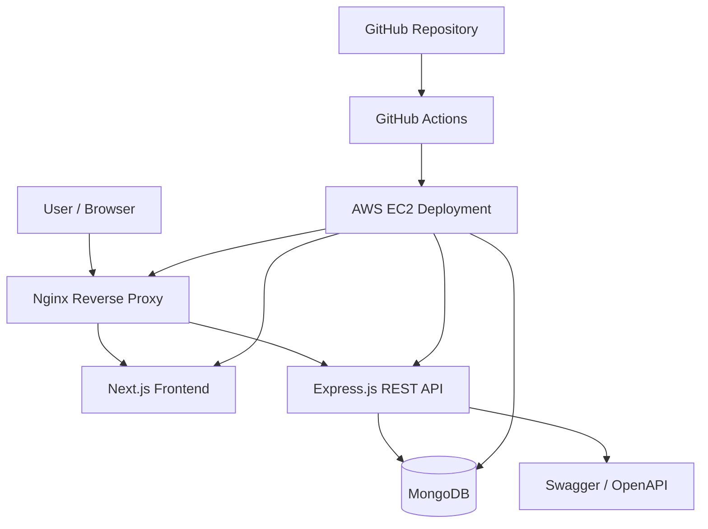

# 🚀 ShowMySkills

**Showcase your skills. Highlight your work. Build your professional presence.**

ShowMySkills is an open-source, full-stack web platform designed to help individuals present their skills and work through a professional online presence. Built with Next.js and Express.js, the project follows a monorepo architecture and includes API documentation, containerized development, and automated deployment to AWS EC2.

🌐 **Live Platform:** [showmyskills.xyphx.com](https://showmyskills.xyphx.com)

📡 **API Base URL:** [showmyskills.xyphx.com/api](https://showmyskills.xyphx.com/api)

📘 **API Documentation:** [Swagger UI](https://showmyskills.xyphx.com/api/docs)

---

## 📑 Table of Contents

- [Overview](#-overview)
- [Technology Stack](#-technology-stack)
- [Architecture](#-architecture)
- [Project Structure](#-project-structure)
- [Getting Started](#-getting-started)
- [Environment Configuration](#-environment-configuration)
- [Running with Docker](#-running-with-docker)
- [API Documentation](#-api-documentation)
- [Development Workflow](#-development-workflow)
- [Production Deployment](#-production-deployment)
- [Contributing](#-contributing)
- [License](#-license)

---

## 🌟 Overview

ShowMySkills aims to make it easier to showcase individual skills and professional work through a dedicated online platform.

The project combines a modern frontend, a RESTful backend, database integration, and a containerized deployment workflow in one codebase.

### Project Goals

- **Professional presentation:** Provide a platform for showcasing skills and work.
- **Modern web architecture:** Use Next.js for the frontend and Express.js for backend services.
- **API-driven development:** Organize backend functionality around documented HTTP endpoints.
- **Developer-friendly setup:** Support local development with Docker Compose.
- **Deployment automation:** Integrate GitHub Actions with AWS EC2 for production deployments.
- **Open-source collaboration:** Maintain a codebase that developers can understand, extend, and contribute to.

> The exact functionality available to end users depends on the features implemented in the current version of the application.

---

## 🛠️ Technology Stack

| Layer | Technology | Purpose |
|---|---|---|
| Frontend | Next.js | Web interface and application routing |
| Backend | Node.js | JavaScript runtime for server-side services |
| API Framework | Express.js | REST API and request handling |
| API Documentation | Swagger / OpenAPI | API documentation and endpoint exploration |
| Database | MongoDB | Persistent document-oriented data storage |
| Containerization | Docker | Consistent application environments |
| Container Orchestration | Docker Compose | Local multi-service development |
| Reverse Proxy | Nginx | HTTP routing between application services |
| CI/CD | GitHub Actions | Automated deployment workflow |
| Production Hosting | AWS EC2 | Application hosting |

---

## 🏗️ Architecture

ShowMySkills uses a multi-service architecture in which the frontend, backend, and database operate as separate components.



### Component Responsibilities

- **Next.js frontend:** Renders the user interface and handles frontend application logic.
- **Express.js backend:** Processes API requests and implements server-side functionality.
- **MongoDB:** Stores application data.
- **Nginx:** Routes incoming requests to the appropriate service.
- **Swagger / OpenAPI:** Documents API endpoints and provides an interface for exploring them.
- **Docker Compose:** Coordinates application containers during local development.
- **GitHub Actions:** Runs the configured production deployment workflow.

---

## 📂 Project Structure

The following is a representative structure. Adjust directory names to match the actual repository.

```text
ShowMySkills-system/
├── .github/
│   └── workflows/
│       └── deploy-ec2.yml
├── frontend/                  # Next.js application
├── backend/                   # Express.js API
├── docker-compose.yml
├── .env.example
├── .gitignore
├── CONTRIBUTING.md
├── CODE_OF_CONDUCT.md
├── LICENSE
└── README.md
```

The frontend and backend directory names may differ depending on the current repository layout.

---

## 🚀 Getting Started

Follow these instructions to set up the project locally.

### Prerequisites

Install the following tools before starting:

- [Git](https://git-scm.com/)
- [Docker Desktop](https://www.docker.com/products/docker-desktop/) or Docker Engine
- [Docker Compose](https://docs.docker.com/compose/)
- [Node.js](https://nodejs.org/) and npm, if running services outside Docker

### 1. Clone the Repository

```bash
git clone <YOUR_GITHUB_REPOSITORY_URL>
cd ShowMySkills-system
```

Replace `<YOUR_GITHUB_REPOSITORY_URL>` with the actual repository URL.

### 2. Configure Environment Variables

Create the required environment files using the provided examples, if available.

```bash
cp .env.example .env
```

Configure the required variables for the frontend, backend, and database.

Do not commit `.env` files containing credentials, API keys, or other secrets.

### 3. Start the Application

If Docker Compose is configured for the complete application:

```bash
docker compose up -d --build
```

Check the running containers:

```bash
docker compose ps
```

View application logs:

```bash
docker compose logs -f
```

Stop the application:

```bash
docker compose down
```

The application will be available at the local addresses configured in Docker Compose.

---

## ⚙️ Environment Configuration

Environment variables depend on the current application configuration. Typical variables may include:

| Variable | Description |
|---|---|
| `NODE_ENV` | Application execution environment |
| `PORT` | Backend server port |
| `MONGODB_URI` | MongoDB connection string |
| `NEXT_PUBLIC_API_URL` | Public API base URL used by the frontend |

These names are examples; use the exact variable names expected by the application's source code and deployment configuration.

For production, configure secrets through GitHub Actions secrets or the appropriate secure environment configuration. Never expose database credentials or private keys through public frontend variables.

---

## 🐳 Running with Docker

Docker Compose provides a convenient way to run the application and its supporting services in a consistent environment.

```bash
docker compose up -d --build
```

### Common Docker Commands

Rebuild and start the services:

```bash
docker compose up -d --build
```

Follow logs:

```bash
docker compose logs -f
```

Inspect service status:

```bash
docker compose ps
```

Restart services:

```bash
docker compose restart
```

Stop and remove containers and the Compose network:

```bash
docker compose down
```

To remove persistent database data as well, a separate volume-removal operation may be required. Review the configured volumes before doing so.

### Local Service URLs

If your Docker configuration uses the ports shown below, the local endpoints are:

| Service | URL |
|---|---|
| Frontend | `http://localhost:3000` |
| Backend API | `http://localhost:5000/api` |
| Swagger UI | `http://localhost:5000/api/docs` |

These ports must match the actual mappings in `docker-compose.yml`. When using Nginx, the public-facing local URL may instead be a single proxy address.

---

## 📘 API Documentation

ShowMySkills uses Swagger / OpenAPI to document its backend API.

**Production documentation:** [https://showmyskills.xyphx.com/api/docs](https://showmyskills.xyphx.com/api/docs)

**Production API base:** [https://showmyskills.xyphx.com/api](https://showmyskills.xyphx.com/api)

Swagger UI can be used to explore documented endpoints, inspect request and response schemas, and test supported API operations.

The available operations and authentication requirements are defined by the current OpenAPI specification and backend implementation.

---

## 🌿 Development Workflow

The repository uses a branch-based development workflow.

| Branch | Purpose |
|---|---|
| `dev` | Active development and feature integration |
| `production` | Production-ready code and deployment |

### Recommended Workflow

1. Create a feature branch from `dev`.
2. Implement your changes and test them locally.
3. Commit your work with a descriptive commit message.
4. Open a pull request targeting `dev`.
5. Review and test the changes before merging.
6. Promote approved changes to `production` when they are ready for release.

```bash
git checkout dev
git pull origin dev

git checkout -b feature/your-feature-name

# Make your changes and run tests

git add .
git commit -m "feat: describe your changes"

git push -u origin feature/your-feature-name
```

Adapt this workflow to the repository's actual branch protection and review policies.

---

## ☁️ Production Deployment on AWS EC2

ShowMySkills is configured for automated production deployment using GitHub Actions and AWS EC2.

**Deployment workflow:** `.github/workflows/deploy-ec2.yml`

When code is pushed to the configured `production` branch, the workflow runs according to its trigger rules and executes the deployment steps defined in the workflow file.

### Required GitHub Secrets

Configure the following repository or environment secrets under **GitHub → Settings → Secrets and variables → Actions**.

| Secret | Description |
|---|---|
| `EC2_HOST` | Public IP address or hostname of the EC2 instance |
| `EC2_USER` | SSH username for the EC2 instance |
| `EC2_SSH_KEY` | Private SSH key used to authenticate the deployment connection |

The workflow must be configured to use these exact secret names.

### Deployment Process

The intended deployment flow is:

1. A change is pushed to the `production` branch.
2. GitHub Actions starts the deployment workflow.
3. The workflow connects to the EC2 instance using SSH.
4. The configured deployment commands update the application.
5. Docker services are rebuilt or restarted as specified by the workflow.
6. The deployed application is available through the production domain.

The actual sequence depends on the implementation in `deploy-ec2.yml`.

### Production Security

- Never commit SSH private keys or production credentials.
- Restrict EC2 security group rules to the required ports.
- Use HTTPS for public application traffic.
- Keep production environment variables outside version control.
- Protect the `production` branch and require reviews where appropriate.
- Review deployment logs and application health after each release.

---

## 🤝 Contributing

Contributions are welcome!

Before contributing, please review the project guidelines:

- [Contributing Guidelines](CONTRIBUTING.md)
- [Code of Conduct](CODE_OF_CONDUCT.md)

### How to Contribute

1. Fork the repository.
2. Create a feature branch.
3. Implement and test your changes.
4. Commit your changes with a clear message.
5. Push your branch to your fork.
6. Open a pull request describing the changes and their purpose.

Please keep pull requests focused, document relevant API changes, and avoid committing secrets or generated build artifacts.

For bugs and feature requests, use the repository's issue tracker if one is available.

---

## 📜 License

This project is distributed under the [MIT License](LICENSE).

See the `LICENSE` file in the repository for the complete license terms.

---

## 🔗 Project Links

- 🌐 **Live Platform:** [showmyskills.xyphx.com](https://showmyskills.xyphx.com)
- 🔌 **Production API:** [showmyskills.xyphx.com/api](https://showmyskills.xyphx.com/api)
- 📘 **Swagger Documentation:** [showmyskills.xyphx.com/api/docs](https://showmyskills.xyphx.com/api/docs)
- 🐳 **Docker:** [Docker Documentation](https://docs.docker.com/)
- ⚙️ **GitHub Actions:** [GitHub Actions Documentation](https://docs.github.com/en/actions)
- ☁️ **AWS EC2:** [Amazon EC2 Documentation](https://docs.aws.amazon.com/ec2/)

---

**ShowMySkills — A platform for showcasing skills, powered by a modern full-stack architecture.**

Built with Next.js, Express.js, MongoDB, Docker, and AWS EC2.
